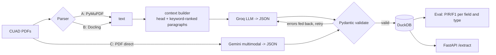

# Contract Document Intelligence (CUAD)

Messy contract PDFs in -> validated, structured JSON out -> scored against expert labels.
Everything runs on **free** tools: Groq (LLM), optional Gemini free tier (multimodal), PyMuPDF/Docling (parsing),
Pydantic, DuckDB, FastAPI, Docker, Hugging Face Spaces, Arize Phoenix (local, open source).



## What we extract (12 fields, 3 types)
| Type | Fields |
|---|---|
| entity | document_name, parties, renewal_term, governing_law |
| date | agreement_date, effective_date, expiration_date |
| clause (yes/no + supporting quote) | non_compete, exclusivity, anti_assignment, cap_on_liability, termination_for_convenience |

Defined once in `src/docintel/fields.py`. Ground truth: CUAD `master_clauses.csv`.

## Quickstart (macOS, Apple Silicon)
```bash
brew install uv                  # or: curl -LsSf https://astral.sh/uv/install.sh | sh
cd cuad-doc-intel
uv sync --extra dev              # uv installs Python 3.12 itself; your system 3.14 is not used
cp .env.example .env             # paste GROQ_API_KEY (free: console.groq.com/keys)
uv run pytest -q                 # 20ish tests, no API needed
uv run docintel download --n 40  # ~100 MB zip, keeps 40 PDFs, deletes the zip
uv run docintel inspect-labels   # verify column names + label stats BEFORE spending quota
uv run docintel run --parser pymupdf --run-id pymupdf_groq --limit 5   # smoke test on 5 docs
uv run docintel run --parser pymupdf --run-id pymupdf_groq             # full run (cached per doc)
uv run docintel evaluate --run-id pymupdf_groq
```
Then the comparison arms:
```bash
uv sync --extra docling && uv run docintel run --parser docling --run-id docling_groq     # big download, do last
uv sync --extra gemini  && uv run docintel run --parser gemini_direct --run-id gemini_direct
uv run docintel evaluate --run-id docling_groq && uv run docintel evaluate --run-id gemini_direct
uv run docintel report           # -> reports/comparison.md
```
API + tracing:
```bash
uv run docintel serve            # http://127.0.0.1:8000/docs
uv sync --extra phoenix && uv run phoenix serve    # UI at :6006, then ENABLE_PHOENIX=1 in .env
```

## Design decisions (the interview talking points)
1. **Documents**: 40 contracts sampled with a fixed seed from CUAD (reproducible), 12 fields chosen to cover free-text, dates and yes/no clauses.
2. **Scoring**: a wrong non-null answer counts as both FP and FN. Documents that fail validation count as misses, never silently dropped.
3. **Context builder**: free tiers cap tokens per minute, so we send the contract head + keyword-ranked paragraphs. Tradeoff: cheaper, but a clause outside the retrieved paragraphs is missed (recall). Measured in the report.
4. **Validation**: Pydantic enforces ISO dates, real calendar dates, quotes required when a clause is present. Errors are returned to the model and it retries; first-pass vs after-retry validity is tracked (`retry_docs`).
5. **Grounding check**: each clause quote must appear in the source text; failures are flagged (`ungrounded`).
6. **Cost vs quality**: three parsing strategies compared on F1, seconds/doc, tokens/doc and hypothetical paid cost.

## Layout
```
src/docintel/  fields.py schema.py labels.py metrics.py context.py extract.py gemini_direct.py
               parsers/ download.py pipeline.py evaluate.py report.py store.py api.py cli.py
tests/         metrics, context, labels, schema
docs/LEARNING_GUIDE.md   day-by-day plan with concepts + questions to answer
deploy/SPACES.md         free deploy
```

## Troubleshooting
- `request too large` / 429: lower `MAX_CONTEXT_CHARS` in `.env`, raise `REQUEST_DELAY_S`.
- `json_schema not accepted`: expected on some models; the code auto-falls back to JSON mode. Or change `GROQ_MODEL` to one listed as supporting structured outputs in Groq docs.
- Column not found in labels: run `docintel inspect-labels`; edit `cuad_column` in `fields.py`.
- Low disk: `du -sh data .venv ~/.cache/uv`; delete `data/parsed` to reclaim space.

CUAD is licensed CC BY 4.0 (The Atticus Project). This is a portfolio project, not legal advice.
