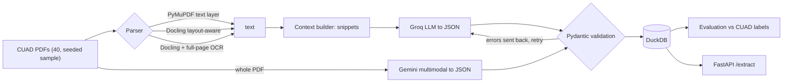
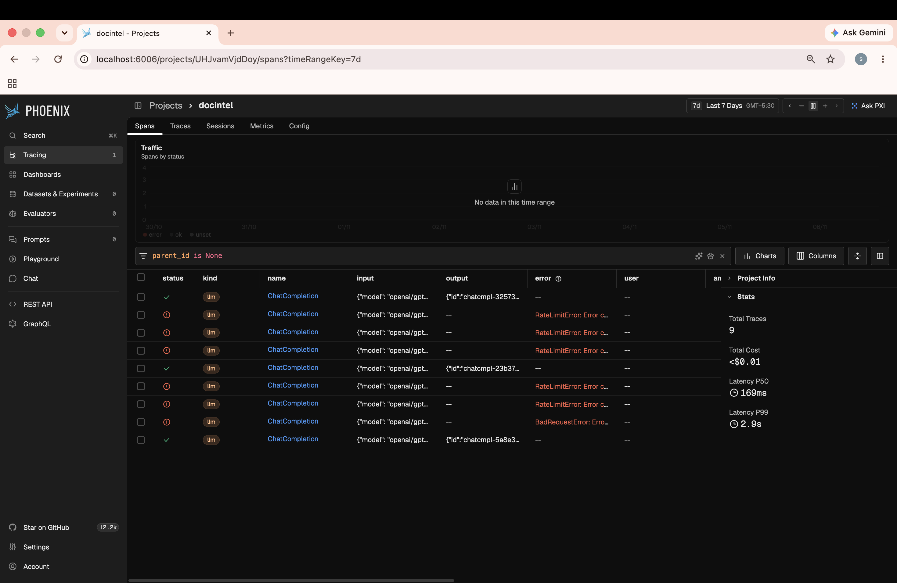

# Document Intelligence Pipeline

Contract PDFs in, schema-validated JSON out, scored against CUAD's lawyer-labeled data.
It compares text-layer, layout-aware, OCR, and whole-document multimodal approaches on 40
contracts, and finds out *why* LLMs miss contract clauses.

**Live API:** https://document-intelligence-pipeline-44lk.onrender.com/docs
(free tier: the first request after idle takes about a minute to wake up)

## What it does
- Reads a contract PDF and extracts 12 fields: parties, dates, governing law, renewal term, and five clause flags with a supporting quote.
- Validates every answer with Pydantic. A bad answer is sent back to the model with the exact error and retried.
- Checks that each clause quote really appears in the contract (hallucination signal).
- Stores results in DuckDB, serves them through FastAPI, traces every LLM call with Arize Phoenix, and ships as a Docker image.
- Scores everything against CUAD labels with precision, recall and F1 per field and per field type.



## Observability
Every LLM call is traced with Arize Phoenix (prompt, response, tokens, latency). The failed rows below are Groq free-tier rate limits, which the code waits out and retries.



## Data
`dataset/` holds the 40 contracts used here (a seeded random sample, seed 42, of the 500 CUAD
contracts that have a PDF), CUAD's `master_clauses.csv` labels, and the sample list.
CUAD is by The Atticus Project, licensed CC BY 4.0: https://www.atticusprojectai.org/cuad

Fields (12): entity = document name, parties, renewal term, governing law; date = agreement,
effective, expiration; clause = non-compete, exclusivity, anti-assignment, cap on liability,
termination for convenience.

## Results (all 40 documents, same documents for every run)

| Setup | Clause F1 | Clause precision / recall | Entity F1 | Date F1 | Parse time per doc |
|---|---|---|---|---|---|
| PyMuPDF text layer + Groq (snippets) | 0.64 | 0.86 / 0.51 | 0.84 | 0.80 | 0.1 s |
| PyMuPDF + per-field retrieval (v2) | 0.65 | 0.88 / 0.51 | 0.83 | 0.79 | 0.1 s |
| PyMuPDF + widened prompt (v3) | 0.68 | 0.92 / 0.54 | 0.86 | 0.82 | 0.1 s |
| Docling layout-aware + Groq | 0.68 | 0.88 / 0.55 | 0.84 | 0.78 | 7.3 s |
| Docling + full-page OCR + Groq | 0.69 | 0.87 / 0.57 | 0.80 | 0.77 | 58.5 s |
| **Gemini, whole PDF** | **0.87** | **0.93 / 0.81** | **0.87** | 0.80 | none |

Biggest per-field gains from reading the whole contract (F1): non-compete 0.14 to 0.70,
cap on liability 0.40 to 0.82, exclusivity 0.56 to 0.91, termination for convenience 0.58 to 0.81,
governing law 0.82 to 0.99.

### Key finding: the model misses clauses it never sees
Clause recall was the weak spot (about 0.51 with Groq). I checked every missed clause in the
per-field-retrieval run against CUAD's labeled clause text: **33 of 41 misses were in the contract
but never sent to the model**, 7 were sent and still missed, and 1 was not found in the parsed text.
The free Groq tier allows 8,000 tokens per minute, which forced me to send snippets.
A smarter parser, a per-field retrieval rewrite, and full-page OCR did not move clause F1
(0.64 to 0.69, within noise). Sending the whole PDF to a multimodal model did (0.87).

### Failure analysis: three real misses
First miss of each type in the v3 error log, with the lawyers' label, what the model said, and
whether the labeled text was inside the excerpt sent to the model:

| Clause | Contract | CUAD label (shortened) | Model | Label text in excerpt? | Cause |
|---|---|---|---|---|---|
| cap_on_liability | Audible co-branding agreement | "EXCEPT FOR LIABILITIES UNDER SECTION 7.2 [Indemnity], NEITHER PARTY'S AGGREGATE LIABILITY ARISING OUT OF OR IN CONNECTION WITH THIS AGREEMENT..." | no clause | **No** | Retrieval: a textbook liability cap was never sent |
| exclusivity | Ambassador Eyewear endorsement agreement | "Nothing in this Agreement shall be construed to prevent KI, Inc. from granting any other licenses..." | no clause | **No** | Retrieval, and the label is a carve-out phrasing, an edge case for any model |
| non_compete | Audible co-branding agreement | "'ACSI Competitor' means, collectively, such persons and entities as the Parties may agree upon..." | no clause | Yes | Model/definition: the text was sent, but it defines a competitor list instead of saying "shall not compete" |

Two of the three were never in the excerpt, which matches the 33-of-41 diagnosis. The third was
seen and missed because CUAD counts a competitor definition as a non-compete, a judgment call.

### Prompt iteration (v3): two different failure modes
After the diagnosis I rewrote the prompt to match how CUAD's lawyers actually label (wider clause
definitions; compute an expiration date from "N years from <date>"; normalize renewal to
"successive N year"). Only the prompt changed (same parser, model and 40 documents).

| Field | v1 F1 | v3 F1 | Reading |
|---|---|---|---|
| expiration_date | 0.51 | **0.70** | recall 0.34 to 0.55: a labeling-definition problem, fixed by the prompt |
| renewal_term | 0.26 | **0.38** | same cause (16 positives, so noisy) |
| cap_on_liability | 0.40 | 0.52 | partial gain; the rest is still not in the excerpt |
| non_compete | 0.14 | 0.14 | no change: the clause is rarely in the excerpt, so a better prompt cannot help |
| clause F1 overall | 0.64 | 0.68 | within noise |

Takeaway: errors came from two separate causes. **Definition mismatches** (what counts as an
expiration date) respond to prompt changes. **Missing context** (the clause was never sent) only
responds to sending more of the document. The Gemini row above used the original prompt, so
its expiration score (0.39) is not comparable to v3 on Groq (0.70).

### Cost and speed
| Setup | Tokens per doc | Hypothetical paid cost per 1,000 docs |
|---|---|---|
| Groq gpt-oss-20b arms | 4,050 - 4,800 | about $0.53 - 0.59 |
| Gemini 3.6 Flash, whole PDF | 8,230 | about $14 |

Everything here ran on free tiers ($0 spent). Prices are looked up, not billed: Groq $0.075 in /
$0.30 out per 1M tokens; Gemini $1.50 / $7.50 per 1M (one source lists half that, so verify before
quoting). The Gemini figure excludes "thinking" tokens, so it is a floor. Whole-document reading
costs roughly 25x more per document than snippets for a 0.18 gain in clause F1.

### Schema validation
Dates must be real ISO dates, a clause flagged present must include a quote, nullish strings
become null, parties are de-duplicated. On a failure the exact validation error goes back to the
model. All runs ended with 40/40 valid records (retries needed: 5, 2, 8, 3, and 0 documents).

### Weak spots
Non-compete stays at 0.14 F1 with snippet prompts (the clause is rarely in the excerpt) and renewal
term is still low (0.38 at best). CUAD often labels a computed end date or a normalized phrase such
as "successive 1 year"; the v3 prompt fixed part of this.

## Limitations
- Gemini and Groq are different models, so "whole document" is mixed with "stronger model". The 33-of-41 diagnosis points to context as the main cause, but I did not isolate it.
- 40 contracts and small per-field counts (11 - 40 positives). Differences under about 0.10 F1 are noise.
- CUAD labels are broader than my prompt definitions (for example, a waiver of consequential damages counts as a liability cap) and sometimes noisy.
- Free tiers shaped the design: Groq 8,000 tokens/minute, Gemini 20 requests/day.
- The v3 prompt was run on Groq only. The Gemini row uses the original prompt, so prompt gains and model gains are not compared like for like.
- The deployed API uses the snippet approach with Groq and is a demo, not a production service.

## Run it
```bash
brew install uv
uv sync --extra dev
cp .env.example .env              # add GROQ_API_KEY (free: console.groq.com/keys)
uv run pytest -q
uv run docintel download --n 40   # or use the copy in dataset/
uv run docintel inspect-labels
uv run docintel run --parser pymupdf --run-id pymupdf_groq
uv run docintel evaluate --run-id pymupdf_groq
uv run docintel compare --runs pymupdf_groq docling_groq gemini_full
uv run docintel serve --port 8001  # http://127.0.0.1:8001/docs
```
Optional extras: `--extra docling`, `--extra gemini`, `--extra phoenix` (local tracing: `uv run phoenix serve`,
then `ENABLE_PHOENIX=1`). Docker: `docker build -t docintel . && docker run -p 7860:7860 --env-file .env docintel`.

## Layout
```
src/docintel/  fields.py schema.py labels.py metrics.py context.py extract.py gemini_direct.py
               parsers/ pipeline.py evaluate.py compare.py report.py store.py api.py cli.py tracing.py
tests/         metrics, context, labels, schema
dataset/       the 40 CUAD contracts + labels
deploy/        RENDER.md (free deploy of the Dockerfile)
```
